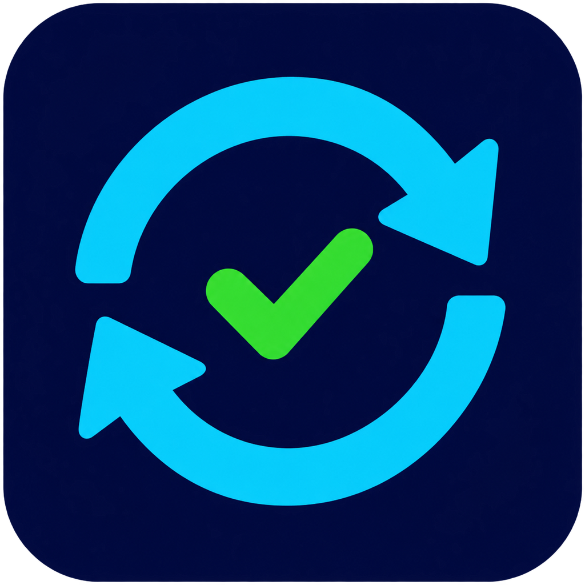

# Check Update

Приложение для Windows 10/11 на C# и WPF (.NET Framework 4.8).

[Скачать последнюю версию](https://github.com/Alekseika2-1IS/check-update/releases/latest) · [История выпусков](https://github.com/Alekseika2-1IS/check-update/releases)

В разделе Releases скачайте **`Check-Update-Setup.exe`** для установки. На первом экране укажите папку вручную или через «Обзор». При первой установке поле пути пустое; при повторной показывается прежняя папка, которую можно изменить. Выбирайте папку с правом записи для вашей учётной записи: установщик проверяет доступ перед продолжением и работает без повышения прав. Можно использовать другую папку или диск. Установщик создаёт ярлык в «Пуск» и по желанию на рабочем столе. После установки можно сразу запустить приложение. Удаление доступно через список установленных приложений в настройках Windows; личные журналы и кэш загрузок сохраняются.

Для запуска без установки доступен **`Check-Update.exe`**. Иконка встроена в файл приложения; дополнительные файлы изображений для запуска не нужны. Уже имеющиеся переносимые копии не перемещаются и не удаляются установщиком.
Нужен WinGet («Установщик приложений» из Microsoft Store).

Интерфейс использует тёмную тему в цветах иконки. Боковая панель переключает обновления и полный список программ; карточки показывают количество найденных программ, доступных обновлений и выбранных установок. Управление обновлением самого Check Update расположено внизу слева.

### Обновления самого Check Update

При запуске приложение проверяет последний стабильный опубликованный выпуск этого репозитория через GitHub API. Если версия новее установленной, внизу слева появится кнопка «Скачать обновление Check Update». Скачивание начинается по нажатию. После проверки SHA-256 и версии файла приложение предложит перезапуск. При отказе можно применить скачанное обновление позднее этой же кнопкой.

Для замены требуется доступ к папке программы на запись; автоматическое повышение прав не используется. Во время установки других программ перезапуск недоступен. Предыдущий файл сохраняется рядом как `.previous`, а при ошибке запуска восстанавливается. Ошибка интернета не мешает пользоваться основным приложением; проверку версии можно повторить вручную. В GitHub передаются обычный запрос версии и User-Agent приложения, без списка установленных программ и локального журнала. Автопроверка выполняется один раз при запуске. Токен GitHub в приложение не встраивается.

1. Нажмите «Проверить обновления».
2. По умолчанию отображаются программы с обновлениями. Снимите фильтр, чтобы увидеть весь распознанный список.
   Поле «Найти программу» фильтрует список по названию или идентификатору без учёта регистра. «Очистить» возвращает полный список. «Выбрать все показанные» отмечает только видимые программы; ранее выбранные скрытые программы сохраняют отметки и перечисляются в подтверждении установки.
3. Отметьте нужные программы и нажмите «Обновить выбранное».
4. Прочитайте подтверждение. Установка начнётся только после согласия; некоторые установщики открывают отдельные окна или запрашивают права администратора.
5. После установки список обновится автоматически. Если Windows ещё показывает старые данные или проверка временно недоступна, приложение повторит её до трёх раз с паузами 3, 6 и 9 секунд. Подтверждённые обновления исчезнут из фильтра «Только с обновлениями». При ошибке список сохраняется, а сообщение объясняет результат проверки.

Индикатор внизу показывает текущий этап и количество обработанных программ. Во время проверки движущийся индикатор показывает ожидание. Во время установки полоса отражает обработанные программы в очереди, а не процент скачивания или установки отдельного пакета: эти данные установщик WinGet не передаёт приложению в структурированном виде.

Программа использует только настроенный источник `winget`, не принимает автоматически соглашения источников и не меняет настройки Windows. Для обновлений используются точные идентификаторы программ и обычные проверки WinGet. Автоматической установки обновлений, фонового запуска и поддержки игровых библиотек в этой версии нет.

Ограничения: каталог охватывает не все приложения; распознавание использует текстовый вывод WinGet и зависит от его формата. Неизвестные и обрезанные идентификаторы пропускаются. Если формат не распознан, проверка показывает ошибку. Повторяющиеся записи одного пакета объединяются. Отсутствие обновления в каталоге не означает, что новейшая версия не существует. Сбой обновления отражается в журнале; откат установщиков не реализован.

Журнал: `%LOCALAPPDATA%/UpdateHub/activity.log`, доступен кнопкой «Открыть журнал». Содержит названия и версии программ; хранится локально.

Сборка: `powershell -ExecutionPolicy Bypass -File .\build.ps1`. Используется системный компилятор .NET Framework, без дополнительных библиотек.

Сборка установщика: `powershell -ExecutionPolicy Bypass -File .\build-installer.ps1`. Для неё используется Inno Setup 6.7.4: при первом запуске скрипт скачивает официальный инструмент, проверяет его подпись Pyrsys B.V. и размещает в пользовательской папке `%LOCALAPPDATA%\CheckUpdateBuild`. Сам Check Update не зависит от установленного Inno Setup. Пользовательские параметры установки и удаления описаны в `setup.iss`.

Проверка установщика: `powershell -ExecutionPolicy Bypass -File .\test-installer.ps1`. Используется отдельное имя приложения и отдельная запись удаления; проверяются файл, ярлыки и очистка после удаления. Папка с остатками предыдущего теста не перезаписывается. В GitHub Actions эти проверки выполняются до публикации установщика.

Повторная подготовка значка из исходного изображения: `powershell -ExecutionPolicy Bypass -File .\prepare-icon.ps1`.

Для нового выпуска измените версию сборки и отображаемую версию в `Program.cs`, обновите `RELEASE_NOTES.md`, сохраните изменения и отправьте тег вида `v0.3.0`. GitHub Actions собирает приложение, запускает автономные проверки, проверяет соответствие тега версии и публикует EXE с SHA-256. Обычные изменения и pull request запускают сборку и проверки без публикации. Сборка не подписана сертификатом издателя.

Проверки: `powershell -ExecutionPolicy Bypass -File .\test.ps1`. На компьютере выполняются также реальная проверка WinGet и загрузка списка в окне. Вариант `test.ps1 -Offline` проверяет приложение на фиксированных данных без интернета и используется в GitHub Actions. Проверяются также распознавание выпусков, допустимый источник, контрольная сумма, замена файла и восстановление при ошибке запуска. Проверки не устанавливают обновления программ на компьютере.

Документация Microsoft: [список программ](https://learn.microsoft.com/en-us/windows/package-manager/winget/list), [обновление программ](https://learn.microsoft.com/en-us/windows/package-manager/winget/upgrade).
